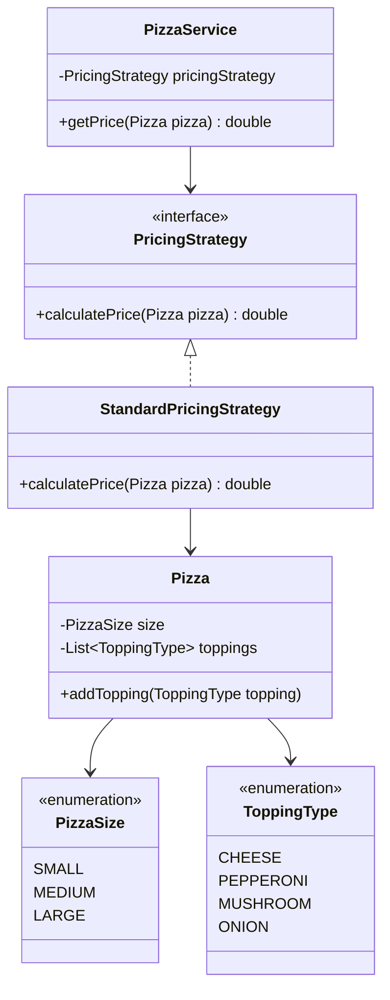

# Pizza Pricing System

## 1. Goal

Design a simple pizza pricing system where a customer can:

- Choose a pizza size
- Add toppings
- Get the final price

The design should be simple and easy to extend.


Design a system that allows a user to calculate the price of a pizza based on its base and toppings.. The system should be simple, storing all data in memory (no persistent storage required).

- A pizza has:
  - **Base**: A foundational element, such as a regular or thin crust.
  - **Toppings**: Additional ingredients (e.g., cheese, pepperoni, vegetables) that are added on top of the base.
- Each base and topping has a specific price.
- Prices are store-specific, so different pizza stores will have different prices for the same base or topping.


## 2. Project Structure

```
src/
└── main/
    └── java/
        └── pizza/
            ├── enums/
            │   ├── PizzaSize.java
            │   └── ToppingType.java
            │
            ├── model/
            │   └── Pizza.java
            │
            ├── strategy/
            │   ├── PricingStrategy.java
            │   └── StandardPricingStrategy.java
            │
            ├── service/
            │   └── PizzaService.java
            │
            └── Main.java
```


## 3. Responsibility of Each Layer

### 3.1 `enums/`

Stores fixed options.

Examples:

- `PizzaSize`
- `ToppingType`

`PizzaSize.java`:

```java
public enum PizzaSize {
    SMALL,
    MEDIUM,
    LARGE
}
```


`ToppingType.java`:

```java
public enum ToppingType {
    CHEESE,
    PEPPERONI,
    MUSHROOM,
    ONION
}
```

### 3.2 `model/`

Stores business objects and data.

`Pizza` contains:

- Size
- Toppings

`Pizza.java`:

```java
public class Pizza {

    private PizzaSize size;
    private List<ToppingType> toppings;

    public Pizza(PizzaSize size) {
        this.size = size;
        this.toppings = new ArrayList<>();
    }

    public void addTopping(ToppingType topping) {
        toppings.add(topping);
    }

    public PizzaSize getSize() {
        return size;
    }

    public List<ToppingType> getToppings() {
        return toppings;
    }
}
```


### 3.3 `strategy/`

Contains replaceable pricing logic.

`PricingStrategy.java`:

```java
public interface PricingStrategy {
    double calculatePrice(Pizza pizza);
}
```

The standard implementation:

`StandardPricingStrategy.java`

```java
public class StandardPricingStrategy implements PricingStrategy {

    @Override
    public double calculatePrice(Pizza pizza) {

        double price = 0;

        switch (pizza.getSize()) {
            case SMALL:
                price = 8;
                break;
            case MEDIUM:
                price = 10;
                break;
            case LARGE:
                price = 12;
                break;
        }

        for (ToppingType topping : pizza.getToppings()) {

            switch (topping) {
                case CHEESE:
                    price += 2;
                    break;
                case PEPPERONI:
                    price += 3;
                    break;
                case MUSHROOM:
                    price += 1.5;
                    break;
                case ONION:
                    price += 1;
                    break;
            }
        }

        return price;
    }
}
```


### 3.5 `service/`

Provides the main business API.

`PizzaService.java`

```java
public class PizzaService {

    private PricingStrategy pricingStrategy;

    public PizzaService(PricingStrategy pricingStrategy) {
        this.pricingStrategy = pricingStrategy;
    }

    public double getPrice(Pizza pizza) {
        return pricingStrategy.calculatePrice(pizza);
    }
}
```


## 4. Main Example

```java
public class Main {

    public static void main(String[] args) {

        Pizza pizza = new Pizza(PizzaSize.LARGE);

        pizza.addTopping(ToppingType.CHEESE);

        pizza.addTopping(ToppingType.PEPPERONI);

        PizzaService service = new PizzaService(new StandardPricingStrategy());

        double price = service.getPrice(pizza);

        System.out.println("Final price: $" + price);
    }
}
```

Output:

```
Final price: $17.0
```


## 5. UML



## 6. Simple Interview Rule

Think of the layers like this:

```text
Model    = WHAT
Service  = DO
Strategy = HOW
Enum     = OPTIONS
```

For this problem:

```text
Pizza                  = WHAT

PizzaSize
ToppingType            = OPTIONS

PricingStrategy        = HOW

PizzaService           = DO
```


## 7. Why Use Strategy Pattern?

The pricing logic may change in the future.

For example:

```java
class StandardPricingStrategy implements PricingStrategy {}
```

Later we could add:

```java
class HolidayPricingStrategy implements PricingStrategy {}
```

```java
class MemberPricingStrategy implements PricingStrategy {}
```

The `PizzaService` does not need to change.

```java
PizzaService service = new PizzaService( new HolidayPricingStrategy());
```

## 8. Reference

- [Pizza Store LLD | Object Oriented Design | Amazon L6](https://leetcode.com/discuss/post/6566858/pizza-store-lld-object-oriented-design-a-kktd/)
